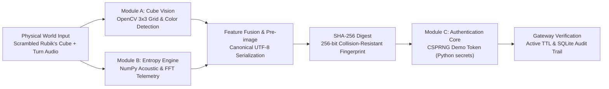

# CubeSec — Cube Entropy-Based Secure Authentication System

CubeSec is a local web prototype exploring physical-world entropy acquisition. It combines computer vision analysis of a scrambled Rubik's Cube, acoustic feature extraction of mechanical scrambling clicks, canonical pre-image serialization, and cryptographically secure session token issuance.

> **Prototype Notice:** CubeSec is developed as an exploratory proof-of-concept for hackathon judges, project evaluators, and cybersecurity enthusiasts. The physical cube state and scramble audio provide demonstrative physical inputs and have not undergone NIST SP 800-90B entropy validation. Session tokens are generated via Python's standard OS CSPRNG (`secrets` module).

---

## Architecture Overview



---

## Core Modules

### 1. Module A: Cube Vision
- **Purpose:** Visual input acquisition and computer vision processing of a scrambled Rubik's Cube.
- **Engine:** Python `cv2` (OpenCV Headless).
- **Features:**
  - Evaluates image sharpness via Laplacian variance (`cv2.Laplacian`) to reject blurry images without fabricating detection.
  - Samples a 3x3 region-of-interest grid across each face (Up, Down, Front, Back, Left, Right).
  - Classifies stickers in HSV color space across 6 canonical Rubik's colors: White (`W`), Yellow (`Y`), Green (`G`), Blue (`B`), Orange (`O`), and Red (`R`).
  - Generates annotated OpenCV visual feedback with sticker bounding boxes and letter tags.
  - Includes sample reference images for immediate testing without a physical cube.

### 2. Module B: Entropy Engine
- **Purpose:** Acoustic feature processing and feature fusion.
- **Engine:** Python `wave` and `numpy`.
- **Features:**
  - In-browser microphone recording via `MediaRecorder` / Web Audio API or WAV file upload.
  - Live waveform visualization on HTML5 canvas.
  - Extracts key acoustic telemetry:
    - Signal duration & sample rate
    - RMS Signal Energy & Peak Amplitude
    - Zero-Crossing Rate (ZCR)
    - Spectral Centroid (mean frequency in Hz)
    - Spectral Roll-off (85th percentile energy)
    - Dominant click resonance frequencies
  - Fuses the 54-sticker cube state with acoustic telemetry into a canonical UTF-8 JSON pre-image.
  - Produces a deterministic SHA-256 digest (`hashlib.sha256`).
  - **Security Qualification:** Clearly highlights that SHA-256 produces a digest, not entropy, and that physical inputs are demonstrative seeds rather than cryptographically certified TRNGs.

### 3. Module C: Authentication Core
- **Purpose:** Demonstration of physical context binding and secure session token management.
- **Engine:** Python `secrets.token_urlsafe(32)`.
- **Features:**
  - Generates 256 bits of OS cryptographically secure randomness (`csec_tok_...`).
  - Binds the session token to the verified physical digest and a configurable TTL (60s, 180s, 600s).
  - Real-time countdown timer in the browser UI.
  - Gateway verification validating active, expired, tampered, and malformed tokens with detailed feedback.

### 4. API Playground
- Interactive developer playground with pre-filled templates for all endpoints:
  - `POST /api/cube/analyze`
  - `POST /api/cube/load-all-samples`
  - `POST /api/audio/analyze`
  - `POST /api/entropy/process`
  - `POST /api/auth/token`
  - `POST /api/auth/verify`
  - `GET /api/session/status`
  - `GET /api/logs`
- Displays round-trip latency (ms), HTTP status codes, formatted JSON, and one-click **Copy cURL** and **Copy Fetch** buttons.

### 5. Security & Activity Logs
- Persistent SQLite database (`cubesec.db`) storing all detection events, acoustic analyses, token issuances, and authentication outcomes.
- Filter by event type or status (SUCCESS, WARNING, FAILED).
- Modal inspection of structured JSON payloads.

### 6. Floating CubeSec Assistant Chatbot
- Bottom-right floating launcher with responsive drawer.
- Lightweight, rule-based client-side JavaScript engine (zero external API keys or cloud dependencies).
- Quick-reply chips and keyword-based answers explaining CubeSec, the modules, digest interpretation, authentication testing, and prototype scope.

---

## Design System

- **Aesthetic:** Restrained, product-focused Apple-like clarity.
- **Light Theme:** Warm neutral surfaces (`#f7f8f9`, card `#ffffff`), deep slate text (`#191c1f`), muted forest green brand accent (`#18633e`).
- **Dark Theme:** Charcoal surfaces (`#111315`, `#181b1e`), light readable text (`#f0f3f6`), crisp muted green accent (`#2ea043`).
- **Typography:** Modern readable system font stack (`-apple-system, BlinkMacSystemFont, "Segoe UI", Roboto, "Helvetica Neue", Arial, sans-serif`).
- **Accessibility:** Theme toggle with `localStorage` persistence and OS `prefers-color-scheme` detection, full keyboard navigation, visible focus indicators, and responsive mobile layout.

---

## Running the Application Locally

### Prerequisites
- Python 3.10+ (Tested on Python 3.13)
- Windows / macOS / Linux

### Installation & Launch
```bash
# 1. Install dependencies
pip install -r requirements.txt

# 2. Run the server
python app.py
```
Open your browser and navigate to:
```
http://127.0.0.1:5000
```
